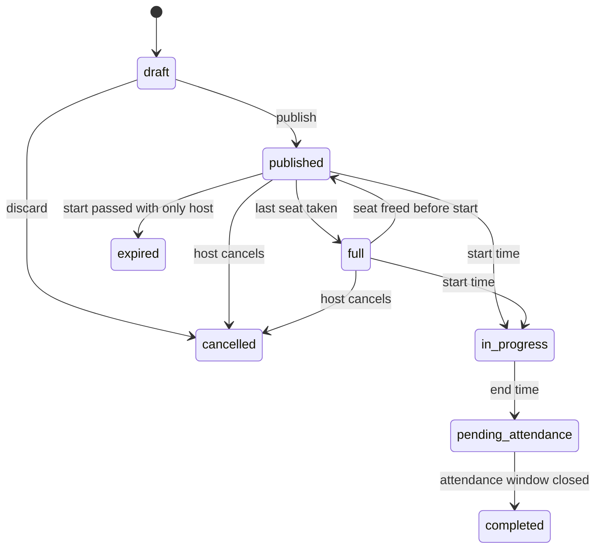
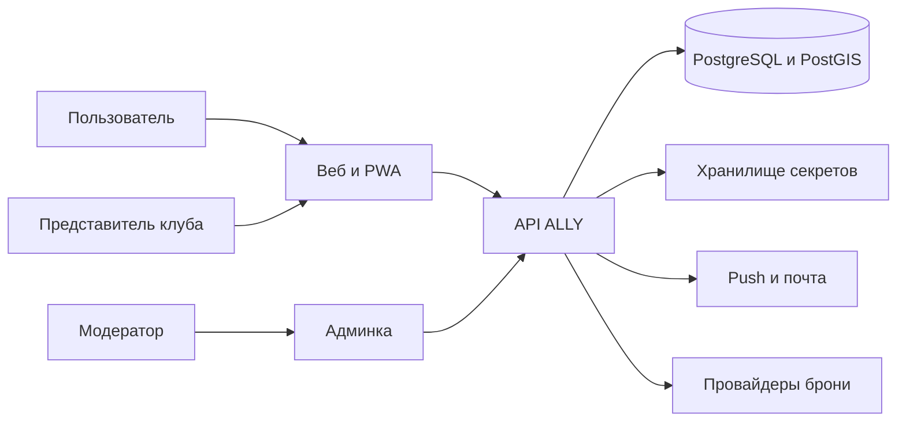
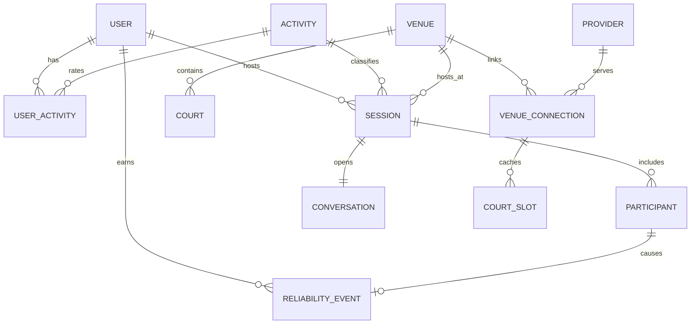

# Техническое задание и архитектура

## Платформа поиска партнёра на активность (кодовое имя ALLY)

**Дата:** 25 октября 2026 (Астрахань, UTC+4)  
**Статус:** основание для разработки пакетов A и B, каркас пакета C  
**Связанный документ:** [Коммерческое предложение](kp.md)  
**Приоритет при расхождении с коммерческим предложением:** этот документ

Документ описывает продукт так, чтобы по нему можно было проектировать данные, API, клиенты и приёмку. Он не заменяет пользовательское соглашение и не является юридическим заключением.

---

## 1. Основания и цель

### 1.1. Зафиксированные решения

Эти решения закрыты. Разработка не переоткрывает их без новой версии задания.

| ID | Решение |
| --- | --- |
| D-01 | Два режима: сессия (основной) и люди (дополнительный). |
| D-02 | Продукт про партнёра на активность. Один вид спорта не выбирается как единственный домен. |
| D-03 | Ядро ценности: сессия, уровень внутри активности, надёжность явки. Свайп-колода не делается. |
| D-04 | Архитектура на весь мир. Первый запуск пользователей и поддержки — РФ и СНГ. |
| D-05 | Падел-клубы мира — слой площадок и коннекторов в первой поставке, а не последующая интеграция «сбоку». |
| D-06 | Сессия создаётся и живёт при недоступности клубного API. |
| D-07 | Уровень не сравнивается между разными активностями. Надёжность явки — общая для человека. |
| D-08 | Первая публичная клиентская поверхность — веб и PWA. Нативные iOS/Android — пакет C. |
| D-09 | Очные сценарии — с 18 лет. |
| D-10 | Оплата корта в первой поставке остаётся у клуба. ALLY хранит ссылку, цену и статус, если их отдал коннектор. |

### 1.2. Цель системы

Дать человеку найти компанию на конкретную активность в конкретное время и довести договорённость до явки, с понятным уровнем и с последствием за неявку.

Для падела дополнительно: найти клуб в мире, понять, как забронировать корт, а для подключённых клубов — видеть слот и открытый матч внутри той же ленты.

### 1.3. Критерии успеха разработки

Система считается пригодной к пилоту, когда выполнены критерии приёмки пакетов A и B из раздела 18. Продуктовые доли живого города задаёт заказчик отдельно; в это задание они не зашиваются числами.

---

## 2. Границы

### 2.1. Внутри системы

- Учётные записи, профили, каталог активностей, уровни.
- Сессии, участники, чат сессии, напоминания, явка, надёжность.
- Поиск людей, связь, личный чат, приглашение в сессию.
- Справочник площадок и кортов, переход к брони, коннекторы, кабинет клуба, админка.
- Модерация: жалоба, блок, бан, журнал решений.
- Локализация ru и en.

### 2.2. Снаружи системы

- Касса клуба и платёжный провайдер клуба.
- Медицинский допуск к спаррингу и страхование.
- Турнирные сетки, лиги, маркет, социальная лента.
- Дейтинг.
- Фоновое отслеживание геопозиции.
- Детские аккаунты.
- Гарантированный договор со всеми вендорами брони к дате первого релиза.

### 2.3. Пакеты

| Пакет | Содержание | Релиз пилота |
| --- | --- | --- |
| A | Ядро сессий, людей, надёжности, веб/PWA, админка | Да |
| B | Площадки, кабинет клуба, каркас коннекторов, боевой адаптер Playtomic на чтение, календарь и ручные слоты | Да |
| C | Нативные приложения, оплата подписки, запись брони там, где договор разрешает запись, следующие боевые адаптеры, импорт внешних рейтингов | После пилота |

Требования ниже помечены приоритетом: **M** — обязательно в A или B, **S** — обязательно, если не ломает срок пилота, **C** — пакет C, **W** — не делается в этой версии задания.

---

## 3. Термины

| Термин | Смысл |
| --- | --- |
| Активность | Вид занятия из каталога: падел, кикбоксинг, шахматы. |
| Семейство | Набор полей матча: корт, единоборства, интеллект, выносливость, зал, общий шаблон. |
| Уровень | Число 1.00–7.00 внутри одной активности. |
| Сессия | Встреча с временем, вместимостью, вилкой уровня и местом или онлайном. |
| Площадка | Клуб, зал, парк, коворкинг, шахматная площадка. Для падела — клуб. |
| Корт | Бронируемый ресурс площадки. Для зала может отсутствовать. |
| Провайдер | Внешняя система брони или источник данных: Playtomic, MATCHi, файл календаря, ручной ввод. |
| Коннектор | Адаптер провайдера за общим портом. |
| Подключение | Связь конкретной площадки с провайдером, внешним идентификатором и секретом. |
| Паспорт возможностей | Набор операций, которые коннектор реально умеет. |
| Надёжность | Балл явки пользователя. |
| Связь | Двустороннее согласие видеть друг друга в контакте и писать лично. |
| Внешняя сессия | Сессия, созданная из открытого матча провайдера. Владелец расписания — провайдер. |

Идентификаторы в базе и API — на английском, в `snake_case` для JSON. Код модулей — на английском. Пользовательские строки — через каталог локализации.

---

## 4. Роли

| Роль | Права |
| --- | --- |
| Гость | Видит публичную карточку сессии и площадки без персональных данных участников сверх имени и уровня. Писать и вступать не может. |
| Пользователь | Создаёт сессии, вступает, ищет людей, пишет в доступных чатах, отмечает явку. |
| Организатор | Пользователь, создавший сессию. Управляет заявками, участниками и отменой. |
| Представитель клуба | Ведёт свои площадки, корты, ручные слоты, подключения. Не видит чужие секреты и личные чаты. |
| Модератор | Очередь жалоб, бан, спорные явки, слияние дублей площадок. |
| Администратор | Каталог активностей, провайдеры, флаги стран, роли сотрудников. |
| Воркер коннектора | Служебный доступ к секрету только на время вызова провайдера. |

Один человек может быть пользователем и представителем клуба. Права клуба не дают прав модератора.

---

## 5. Сценарии

### UC-01. Регистрация

1. Человек указывает почту или телефон, подтверждает одноразовым кодом, либо входит через Apple или Google.
2. Указывает дату рождения. Меньше 18 полных лет — учётная запись не создаётся.
3. Указывает имя, город, язык интерфейса.
4. Выбирает одну или несколько активностей и проходит короткий самооценка-уровень по каждой.

Альтернатива: город не найден — человек отправляет название, модератор заводит город, до этого сессии создаются с произвольной подписью места и координатой, если человек указал точку.

### UC-02. Публикация сессии

1. Выбор активности.
2. Форма семейства (для падела — формат и клуб, для кикбоксинга — интенсивность и вес, для шахмат — контроль времени и онлайн/офлайн).
3. Вилка уровня, число мест, начало, длительность.
4. Публикация. Создаётся чат. Ссылка копируется.

Если выбран падел-клуб с живым чтением слотов, форма предлагает свободные корты. Выбор слота необязателен: можно указать время и оставить бронь на клуб.

### UC-03. Вступление

1. Человек открывает ссылку или карточку в ленте.
2. Система проверяет возраст, блок, вилку уровня, места, минимальную надёжность, а для единоборств — подтверждение интенсивности.
3. При политике «открытая» место занимается сразу. При политике «по заявке» организатор принимает или отклоняет.
4. Участник попадает в чат.

Переполнение мест невозможно: занятие места — одна транзакция с блокировкой строки сессии.

### UC-04. Явка

1. За 30 минут до начала у участника открывается действие «я на месте».
2. После конца сессии есть 24 часа, чтобы другой участник подтвердил или оспорил.
3. Нет спора — самоотметка становится явкой.
4. Спор уходит модератору, балл не пересчитывается до решения.
5. Если к началу кроме организатора никто не вступил, сессия становится `expired`. Явка никому не начисляется: собирать компанию не с кем.

### UC-05. Поиск человека и приглашение

1. Фильтр: активность, вилка уровня, город или радиус, язык, минимальная надёжность, «только онлайн» для интеллектуальных.
2. Открывает профиль.
3. Либо приглашает в свою будущую или уже опубликованную сессию, либо запрашивает связь.
4. После принятия связи доступен личный чат.

### UC-06. Клуб подключает бронь

1. Представитель находит площадку и подтверждает право (рабочая почта домена клуба, код от аккаунт-менеджера или ручная проверка модератором).
2. Выбирает провайдера. Форма показывает только те поля, которые нужны паспорту.
3. Секрет сохраняется в хранилище секретов. Клиент получает лишь статус подключения.
4. Воркер читает корты и слоты. Ошибка провайдера видна в кабинете и не удаляет площадку.

### UC-07. Внешний открытый матч

1. Коннектор забирает открытый матч клуба.
2. Система создаёт или обновляет внешнюю сессию по внешнему идентификатору.
3. Вступление в ALLY, если провайдер не умеет запись участника, ведёт на карточку матча у провайдера и параллельно отмечает намерение «я иду» у нас.
4. Явка по таким сессиям считается по отметке в ALLY. Статус мест у провайдера, если он читается, перекрывает локальную вместимость и помечается как внешний.

---

## 6. Функциональные требования

Идентификатор стабилен. Формулировка «система» означает сервер: клиент не является источником истины для мест, балла и слотов.

### 6.1. Учётная запись и профиль

| ID | Приор. | Требование |
| --- | --- | --- |
| FR-ACC-01 | M | Регистрация по почте и по телефону, код живёт 10 минут, не больше 5 попыток на код и не больше 5 кодов в час на адрес или номер. |
| FR-ACC-02 | M | Вход через Apple и Google. |
| FR-ACC-03 | M | Дата рождения обязательна. Регистрация до 18 лет отклоняется. |
| FR-ACC-04 | M | Сессия входа: короткий access-токен и обновляемый refresh с ротацией. Выход инвалидирует refresh. |
| FR-ACC-05 | M | Профиль: отображаемое имя, город, языки общения, текст «о себе» до 500 знаков, до 6 фото. Телефон и почта другим пользователям не показываются. |
| FR-ACC-06 | M | Удаление учётной записи помечает профиль удалённым, снимает будущие участия, закрывает личные чаты. Прошедшие явки остаются в агрегатах без имени. |
| FR-ACC-07 | S | Вход через Telegram. |
| FR-ACC-08 | M | Язык интерфейса ru или en, смена без перерегистрации. |

### 6.2. Каталог и уровень

| ID | Приор. | Требование |
| --- | --- | --- |
| FR-ACT-01 | M | Активность: код, семейство, включена ли, порядок, перевод названия и описания на ru и en, шаблон вместимости (минимум, максимум, значение по умолчанию), можно ли онлайн. |
| FR-ACT-02 | M | Пользователь включает активность у себя и задаёт уровень 1.0–7.0 с шагом 0.5 на самооценке. В базе уровень хранится с шагом 0.01. |
| FR-ACT-03 | M | Семейство определяет обязательные поля сессии. Публикация без них отклоняется. |
| FR-ACT-04 | M | Поиск и лента сравнивают уровень только внутри одной активности. |
| FR-ACT-05 | M | Стартовый каталог содержит падел, теннис, пиклбол, бадминтон, кикбоксинг, бокс, тайский бокс, BJJ, шахматы, бег, велосипед, силовую тренировку и общий шаблон для добавления новых записей из админки. |
| FR-ACT-06 | C | Внешний рейтинг хранится отдельно и предлагает уровень. Человек подтверждает подстановку сам. |
| FR-ACT-07 | M | Администратор добавляет активность общего семейства без выкладки кода. Новое семейство — изменение кода. |

Самооценка при включении активности — четыре вопроса семейства, на выходе уровень и короткая подпись («играю редко», «клубный уровень», «хожу в спарринг»). Подпись переводится. Формула вопросов — конфиг каталога, не зашитые строки клиента.

Рекомендуемое начальное отображение шкалы для ракетки и общего шаблона:

| Балл | Смысл для человека |
| --- | --- |
| 1.0–1.5 | Первый опыт |
| 2.0–2.5 | Уверенный новичок |
| 3.0–3.5 | Играю регулярно |
| 4.0–4.5 | Крепкий любитель |
| 5.0–5.5 | Клубные соревнования |
| 6.0–6.5 | Сильный турнирный уровень |
| 7.0 | Профессиональная практика |

Для шахмат подпись дополняется ориентиром Elo, это подсказка, не проверка аккаунта: до 800, 800–1200, 1200–1600, 1600–2000, 2000–2300, 2300+. Для единоборств рядом живёт стаж и готовность к контакту, они не схлопываются в один «пояс».

### 6.3. Сессии

| ID | Приор. | Требование |
| --- | --- | --- |
| FR-SES-01 | M | Поля сессии: активность, организатор, начало, длительность, пояс площадки или профиля, город, онлайн-адрес или площадка, вилка уровня, вместимость, политика вступления, статус, текст до 1000 знаков. |
| FR-SES-02 | M | Статусы сессии: `draft`, `published`, `full`, `in_progress`, `pending_attendance`, `completed`, `cancelled`, `expired`. |
| FR-SES-03 | M | Политика вступления: `open` или `approve`. |
| FR-SES-04 | M | Вместимость — это число людей вместе с организатором, не меньше 2 и не больше максимума каталога. При публикации организатор занимает одно место как участник с ролью `host` и статусом `joined`. Гонка двух вступлений на последнее свободное место оставляет одного. |
| FR-SES-05 | M | Лента города: активность, интервал дат, вилка уровня, только со свободными местами, радиус от точки. Сортировка по умолчанию: близость времени, попадание в уровень, расстояние, надёжность организатора. |
| FR-SES-06 | M | Публичная ссылка `/s/{id}` открывается гостем. Персональные данные сверх публичной карточки скрыты. |
| FR-SES-07 | M | Отмена сессии организатором переводит статус в `cancelled`, пишет в чат системное сообщение и шлёт уведомление участникам. |
| FR-SES-08 | M | Участник выходит сам до начала. После начала выход считается вопросом явки, а не тихим удалением. |
| FR-SES-09 | M | Напоминания за 24 часа и за 2 часа, если до начала больше этого интервала. |
| FR-SES-10 | M | Черновик виден только организатору. |
| FR-SES-11 | S | Лист ожидания, если мест нет. |
| FR-SES-12 | S | Экспорт сессии в файл календаря `.ics`. |
| FR-SES-13 | M | Повторная публикация «ещё раз с этими людьми» создаёт новую сессию и приглашения, не клонирует явку и чат. |
| FR-SES-14 | W | Бесконечная серия расписания в первой поставке. Одно повторение — новая сессия. |

Обязательные поля семейств при `published`:

| Семейство | Обязательно сверх общей карточки |
| --- | --- |
| Корт | Формат (`doubles` для падела по умолчанию), площадка из справочника или адрес с координатой |
| Единоборства | Интенсивность: `technique`, `light`, `hard`; весовая зона организатора; площадка или адрес зала. Участник перед вступлением подтверждает, что интенсивность ему подходит |
| Интеллект | Контроль времени текстом из справочника (`3+2`, `10+0`, `30+0`, `без часов`), режим `online` или `offline` |
| Выносливость | Ориентир темпа или дистанции, точка старта |
| Зал | Цель из короткого списка (`сила`, `общий`, `кардио`), место |
| Общий | Место или онлайн |

Падел: вместимость по умолчанию 4, публиковать можно, когда занято хотя бы место организатора: остальные места ищутся. Шахматы и спарринг: по умолчанию 2, то есть организатор и ещё один человек. Групповая тренировка зала: максимум задаёт каталог, верхняя граница системы — 50 мест на сессию. Фраза «осталось 1 место» на карточке означает одно свободное место из вместимости.

### 6.4. Участники

| ID | Приор. | Требование |
| --- | --- | --- |
| FR-PAR-01 | M | Статусы участника: `requested`, `joined`, `declined`, `left`, `removed`, `attended`, `late`, `no_show`. Роль — `host` или `member`. Организатор не подаёт заявку сам на себя и не может выйти так, чтобы сессия осталась без `host`: его путь — отмена сессии. |
| FR-PAR-02 | M | Вступить нельзя, если есть блок в любую сторону, пользователю нет 18 лет, уровень вне вилки или сессия не принимает новых участников (`published`, а для листа ожидания ещё и `full`). Отдельные отказы по надёжности: у пользователя со статусом «новый» отказ только если организатор выключил допуск новичков; у пользователя с числовым баллом отказ, если балл ниже порога сессии. |
| FR-PAR-03 | M | Порог надёжности задаёт организатор, по умолчанию порога нет. Флаг «пускать новых» по умолчанию включён. |
| FR-PAR-04 | M | Для интенсивности `hard` вступление требует отдельного подтверждения на этом шаге, факт хранится у участника. |
| FR-PAR-05 | M | Организатор исключает участника до начала. Участник получает уведомление. |

### 6.5. Люди

| ID | Приор. | Требование |
| --- | --- | --- |
| FR-PPL-01 | M | Поиск только среди пользователей, включивших ту же активность. |
| FR-PPL-02 | M | Фильтры: вилка уровня, город, радиус, язык общения, минимальная надёжность, для интеллекта — онлайн. |
| FR-PPL-03 | M | Карточка: имя, фото, город или район, уровень выбранной активности, надёжность, языки, короткий текст. Точный адрес дома не хранится и не показывается. |
| FR-PPL-04 | M | Сортировка по умолчанию: попадание уровня, расстояние, надёжность, давность последней завершённой сессии. Веса фиксированы и описаны в разделе 7. Скрытого «рейтинга привлекательности» нет. |
| FR-PPL-05 | M | Запрос связи: `pending`, `accepted`, `declined`. Повторный запрос после отказа не раньше 30 дней. |
| FR-PPL-06 | M | Приглашение в сессию создаёт уведомление. Принятие приглашения идёт по правилам вступления UC-03. |
| FR-PPL-07 | W | Свайп, суперлайк, дневной лимит лайков, взаимный лайк как единственный способ открыть чат. |

Веса сортировки людей, нормализованные внутри выдачи города:

- попадание в середину вилки уровня — вес 0.40;
- близость — вес 0.25;
- надёжность — вес 0.20; у статуса «новый» в этот компонент подставляется нейтральное значение 0.70 вместо скрытого балла;
- завершённая сессия за последние 30 дней — вес 0.15.

Это правило продукта, не рекомендация на усмотрение клиента.

### 6.6. Чаты и уведомления

| ID | Приор. | Требование |
| --- | --- | --- |
| FR-CHT-01 | M | У опубликованной сессии один групповой чат. Состав — текущие `joined` и организатор. Вышедший читает историю до выхода и не пишет после. |
| FR-CHT-02 | M | Личный чат существует только при `accepted` связи. |
| FR-CHT-03 | M | Сообщение: текст до 2000 знаков, время, автор. Вложения первой поставки — изображения до 5 МБ, не больше 4 на сообщение. |
| FR-CHT-04 | M | Жалоба на сообщение. |
| FR-CHT-05 | M | Доставка в клиент по WebSocket, пока приложение открыто. Истина сообщений — в базе. Пропущенное догоняется запросом после `cursor`. |
| FR-NOT-01 | M | События: заявка, вступление, выход, исключение, отмена, напоминание, явка открыта, сообщение, запрос связи, приглашение. |
| FR-NOT-02 | M | Каналы: in-app и web push. Письмо — для кода входа и отмены сессии. |
| FR-NOT-03 | S | Пользователь выключает классы уведомлений, кроме кода входа и бана. |

### 6.7. Площадки и клубы

| ID | Приор. | Требование |
| --- | --- | --- |
| FR-VEN-01 | M | Площадка: название, страна, город, адрес, координата, часовой пояс, активности, телефоны и ссылки для публичной карточки, статус (`unverified`, `verified`, `closed`). |
| FR-VEN-02 | M | Корт: площадка, название, активность, крытый или нет, внешний идентификатор провайдера. |
| FR-VEN-03 | M | Сессия корта ссылается на площадку. Ссылку на корт можно не указывать. |
| FR-VEN-04 | M | У площадки есть один или несколько способов брони: `url`, `phone`, `widget`, `in_app` (последний только при паспорте записи, пакет C). |
| FR-VEN-05 | M | Поиск площадок по городу, активности, имени и радиусу. |
| FR-VEN-06 | M | Импорт справочника из CSV с указанием лицензии и источника. Запись без права использования в прод не попадает. |
| FR-VEN-07 | M | Дедупликация предлагает пару, если расстояние меньше 150 метров и нормализованные названия похожи. Слияние делает модератор. Сессии остаются на выжившей площадке. |
| FR-VEN-08 | M | Представитель клуба после подтверждения правит публичные поля, корты и способы брони своей площадки. |
| FR-VEN-09 | M | Ручной слот: корт, начало, конец, цена, валюта, статус `free` или `blocked`. |
| FR-VEN-10 | M | Подключение календаря iCal по URL, который отдал клуб. Занятые интервалы закрывают соответствующие ручные и кэшированные слоты. |
| FR-VEN-11 | S | Заявка «моего клуба нет в списке» создаёт площадку со статусом `unverified`. |

### 6.8. Коннекторы

| ID | Приор. | Требование |
| --- | --- | --- |
| FR-CON-01 | M | Провайдер описан данными: код, название, паспорт возможностей, шаблон ссылки, включён ли в прод. |
| FR-CON-02 | M | Паспорт — множество из `directory_read`, `availability_read`, `open_match_read`, `webhook_in`, `booking_write`. Клиент и сессия проверяют паспорт, а не имя Playtomic. |
| FR-CON-03 | M | Подключение хранит площадку, провайдера, внешний id площадки, ссылку на секрет, статус, время успешного чтения, текст последней ошибки без секрета и без персональных данных игроков. |
| FR-CON-04 | M | Секрет недоступен публичному API, логам приложения и трассировкам. В логе — идентификатор подключения и код ошибки провайдера. |
| FR-CON-05 | M | Боевой адаптер пакета B: Playtomic, чтение площадки, кортов, броней и открытых матчей в рамках публичного контракта клуба. Запись брони этим адаптером не реализуется. |
| FR-CON-06 | M | Каркас адаптеров MATCHi, CourtReserve и «клуб РФ» компилируется, имеет паспорт и тесты на фикстурах. Сетевые вызовы в прод выключены флагом, пока нет договора и секрета. |
| FR-CON-07 | M | Сбой, таймаут и 401 провайдера не отменяют сессии. Слоты этого подключения помечаются `stale`. В карточке сессии показывается «доступность корта неизвестна». |
| FR-CON-08 | M | Повторная синхронизация идемпотентна по внешнему идентификатору слота и открытого матча. |
| FR-CON-09 | M | Вебхук принимается только при подписи, которую задаёт паспорт. Без подписи тело отвергается. |
| FR-CON-10 | C | `booking_write` создаёт намерение брони отдельной сущностью со статусами и не занимает корт локально раньше подтверждения провайдера. |
| FR-CON-11 | M | Представитель клуба отзывает подключение. Секрет удаляется, слоты помечаются устаревшими, площадка остаётся. |

Ограничения, которые команда обязана соблюдать как факты контракта, а не как догадку на момент октября 2026:

- Сторонний API Playtomic для клуба — чтение. Доступ выдаёт клуб уровня Champion или Master (или сеть клубов по правилам Playtomic). История броней, которую отдаёт API, ограничена окном провайдера; для слотов сессий интересны будущие и текущие.
- Имена полей провайдера не протекают в клиент ALLY. На границе адаптера они переводятся во внутреннюю модель `CourtSlot` и `ExternalOpenMatch`.
- Обход авторизации, парсинг закрытых кабинетов и использование чужих клиентских токенов приложений клубов запрещены. Источники справочника — лицензия, открытый набор с атрибуцией, ручной ввод, кабинет клуба, договорной API.

### 6.9. Модерация

| ID | Приор. | Требование |
| --- | --- | --- |
| FR-MOD-01 | M | Пользователь блокирует пользователя. Блок скрывает профили, запрещает связь, личный чат и вступление в сессию друг друга. |
| FR-MOD-02 | M | Жалоба: цель (профиль, сообщение, сессия, площадка), причина из списка, комментарий. |
| FR-MOD-03 | M | Модератор: без действия, предупреждение, скрытие объекта, бан пользователя с причиной. |
| FR-MOD-04 | M | Бан не даёт войти и опубликовать. Будущие участия снимаются. |
| FR-MOD-05 | M | Спор явки решается в пользу `attended`, `late`, `no_show` или «снять событие». У решения есть автор и комментарий. |
| FR-MOD-06 | S | Очередь новых фото до показа в поиске людей. В сессионном чате изображение видно сразу, на него можно пожаловаться. |

---

## 7. Уровень, выдача и надёжность

### 7.1. Попадание в вилку

Уровень пользователя `L`, вилка сессии `[min, max]`, оба края включительно.

Пользователь без уровня этой активности в ленту этой активности не попадает и вступить не может, пока уровень не задан.

### 7.2. События надёжности

| Событие | Когда | Вес |
| --- | --- | --- |
| `attended` | Явка подтверждена | +1.0 |
| `late` | Контакт с сессией был, опоздание больше 10 минут | +0.4 |
| `cancel_ok` | Участник вышел не позднее чем за 12 часов до начала | 0 |
| `cancel_late` | Участник вышел меньше чем за 12 часов, сессия ещё не началась | −0.7 |
| `no_show` | Сессия началась, явки нет, спор не выигран | −1.5 |
| `host_cancel_ok` | Организатор отменил сессию не позднее чем за 12 часов | 0 |
| `host_cancel_late` | Организатор отменил сессию меньше чем за 12 часов при наличии хотя бы одного `joined` | −0.7 организатору, участникам событие не ставится |

Окно расчёта — 90 дней, не больше 30 последних событий. Если событий меньше, в знаменателе всё равно 3: одна удача или одна неявка не ставят 100 или 0.

```
raw = sum(weight of events in window) / max(count(events), 3)
score = clamp(round(70 + 30 * raw), 0, 100)
```

Примеры, которые обязаны совпасть с тестами:

| История | raw | Внутренний score | Что видят другие |
| --- | --- | --- | --- |
| Нет событий | — | — | «новый» |
| 1 явка | 1 / 3 | 80 | «новый», число скрыто |
| 3 явки | 3 / 3 | 100 | 100 |
| 2 явки и 1 неявка | (2 − 1.5) / 3 | 75 | 75 |
| 3 неявки | −4.5 / 3 | 25 | 25 |

Статус `new`, пока завершённых событий меньше 3 (`attended`, `late`, `no_show`, поздние отмены считаются). До этого окружающие видят подпись «новый», число не отдаётся API в чужие карточки. Своё число пользователь видит.

Пересчёт идёт при фиксации события. Спорное событие в сумму не входит, пока статус спора `open`.

Организатор не получает `no_show` отдельно от участников: если он не отметился, к нему применяется то же правило участника. Отмена сессии — единственный отдельный путь организатора.

Подкрутка взаимными ложными явками ограничивается так: событие `attended` между двумя пользователями на сессиях короче 30 минут не больше двух раз за 7 дней даёт вес. Остальные такие события пишутся в журнал с весом 0 и причиной `density_cap`. Это не скрывается от модератора.

### 7.3. Состояния сессии



`expired` не создаёт событий явки.

---

## 8. Архитектура

### 8.1. Принцип

Один модульный монолит и отдельные процессы воркеров из того же репозитория. Микросервисы на пилоте не вводятся. Граница будущего разделения — модуль, у которого уже есть свой порт наружу: коннекторы, уведомления, поиск.

Клиенты говорят только с API. Клиент не ходит в Playtomic и не хранит клубный секрет.

### 8.2. Контекст



### 8.3. Контейнеры

| Контейнер | Ответственность |
| --- | --- |
| `web` | Публичный клиент и кабинет клуба |
| `admin` | Модерация и каталог. Можно тем же веб-приложением за отдельным входом |
| `api` | HTTP и WebSocket, авторизация, транзакции сессий |
| `worker` | Синхронизация коннекторов, напоминания, пересчёт надёжности, импорт справочника |
| `postgres` | Данные и геопоиск |
| `redis` | Очередь заданий, ограничение частоты, присутствие сокета |
| `object storage` | Фото |
| `secret store` | Секреты подключений, ключи подписи вебхуков |

Регион первого запуска — один. У пользователя и площадки есть поле `data_region`. Запросы пилота обслуживаются регионом `primary`. Перенос региона — операция эксплуатации, не ветка в каждом запросе. Открытие ЕС и хранение данных граждан РФ согласуются до смены региона, см. раздел 14.

### 8.4. Модули

| Модуль | Делает | Не делает |
| --- | --- | --- |
| `identity` | Вход, токены, возраст, бан | Профили активностей |
| `catalog` | Активности, семейства, переводы | Сессии |
| `profile` | Профиль, активности пользователя, уровень | Поиск по гео |
| `sessions` | Сессия, места, состояние | Вызов провайдера |
| `attendance` | Явка, споры, балл | Чат |
| `people` | Поиск, связь, приглашение | Ленту сессий |
| `messaging` | Чаты и вложения | Push напрямую в обход уведомлений |
| `notifications` | Доставка по каналам | Бизнес-решение, кому можно писать |
| `venues` | Площадки, корты, дедуп, способы брони | Протокол Playtomic |
| `connectors` | Порт, адаптеры, синхронизация, внешние сессии | Правила вступления |
| `moderation` | Жалобы, блоки, решения | Самостоятельное изменение балла без события |
| `admin` | Состав операций сотрудника | Отдельная база |

Модуль `sessions` спрашивает `venues` и `connectors` через интерфейс `AvailabilityGateway`: «что известно про слот». Реализация возвращает `known`, `stale` или `unknown`.

### 8.5. Порт коннектора

Контракт пакета B. Новый провайдер — новый класс и запись в реестре, без миграции сессий.

```ts
type Capability =
  | "directory_read"
  | "availability_read"
  | "open_match_read"
  | "webhook_in"
  | "booking_write";

interface BookingConnector {
  readonly providerCode: string;
  capabilities(): Capability[];

  pullVenue(connection: ConnectionRef): Promise<VenueSnapshot>;
  pullAvailability(
    connection: ConnectionRef,
    range: TimeRange,
  ): Promise<CourtSlotSnapshot[]>;
  pullOpenMatches(
    connection: ConnectionRef,
    range: TimeRange,
  ): Promise<ExternalOpenMatchSnapshot[]>;

  parseWebhook?(
    headers: Readonly<Record<string, string>>,
    body: Uint8Array,
  ): Promise<WebhookEvent[]>;
}

interface BookingWriter {
  createBooking(intent: BookingIntent): Promise<BookingReceipt>;
  cancelBooking(receipt: BookingReceipt): Promise<void>;
}
```

`BookingWriter` реализуют только адаптеры с `booking_write`. Код сессии получает писателя из реестра по паспорту. Нет паспорта — кнопка «забронировать у нас» не рисуется, рисуется переход к клубу.

Снимок слота внутри системы:

| Поле | Смысл |
| --- | --- |
| `external_slot_id` | Идемпотентный ключ вместе с `connection_id` |
| `court_external_id` | Корт |
| `starts_at`, `ends_at` | Абсолютное время |
| `status` | `free`, `held`, `booked`, `closed` |
| `price_amount`, `currency` | Если провайдер отдал. Иначе пусто |
| `handoff_url` | Куда вести человека |
| `fetched_at` | Момент чтения |
| `fresh_until` | Дальше слот `stale` |

`fresh_until` для чтения по расписанию — 15 минут. Для вебхука, который подтвердил конкретный слот, — 6 часов или до следующего противоречащего события. Значения — настройки провайдера, не константа в компоненте ленты.

Открытый матч проецируется в сессию:

- внешний ключ `(provider_code, external_match_id)` уникален;
- организатор в интерфейсе — площадка, не вымышленный человек;
- местные участники ALLY не считаются занятыми местами провайдера, пока провайдер сам не подтвердил состав;
- карточка показывает источник: «матч клуба в {имя провайдера}».

### 8.6. Синхронизация

1. Планировщик ставит задание на подключение, у которого паспорт содержит чтение и статус `active`.
2. Интервал по умолчанию — 10 минут на подключение. Параллельность на один `provider_code` ограничена, чтобы не выбить лимит клуба.
3. Ошибка сети: три попытки с увеличением паузы, затем статус подключения `degraded`, слоты `stale`.
4. Ответ 401 или 403: статус `auth_failed`, секреты в лог не пишутся, представитель клуба получает уведомление.
5. Успех: слоты и матчи upsert, отсутствующие в ответе будущие слоты этого подключения помечаются `closed`, если провайдер отдаёт полное окно. Если отдаёт дельту — закрытие делается только по явному событию.
6. Курсор и сырой идентификатор хранятся у подключения. Повтор задания с тем же курсором безопасен.

Импорт справочника — отдельный поток: файл → строки `venue_import` → правила дедупа → решение модератора при низкой уверенности → площадка. Автослияние разрешено только при совпадении внешнего идентификатора того же провайдера.

### 8.7. Намерение брони (пакет C)

Пока записи нет, этот раздел — обязательный каркас сущности, без рабочего адаптера.

`booking_intent`: сессия, пользователь, слот, статус `draft | submitted | confirmed | rejected | expired`, идемпотентный ключ, внешний идентификатор, ошибка.

Локальное место в сессии и корт у провайдера — разные резервы. Занятие места в сессии не означает, что корт удержан. Текст интерфейса обязан это говорить, пока статус намерения не `confirmed`.

### 8.8. Клиенты

Веб-приложение:

- адаптив от 360 px;
- PWA: манифест, установка, push;
- карта через `MapProvider` (тайлы и геокодер подменяются конфигурацией региона);
- язык из профиля, до входа — из `Accept-Language`, запасной `en`, для региона пилота запасной `ru` допустим настройкой сборки.

Натив пакета C использует тот же API. Отдельной бизнес-логики мест и балла в клиенте нет.

### 8.9. Рекомендуемый стек

Стек можно заменить эквивалентом до старта пакета A, если сохраняются границы модулей, PostgreSQL с геопоиском и порт коннектора.

| Слой | Выбор |
| --- | --- |
| Язык сервера | TypeScript |
| API | Модульный HTTP-сервис на NestJS |
| База | PostgreSQL 16 + PostGIS |
| Очередь | Redis и BullMQ |
| Файлы | S3-совместимое хранилище |
| Веб | React, отдельное приложение в монорепозитории |
| Карты | MapLibre, геокодер за интерфейсом |
| Наблюдаемость | OpenTelemetry, структурированные логи JSON |
| Секреты | Менеджер секретов облака или Vault, не `.env` на диске пода с секретом клуба в открытом виде |

Поиск пилота — SQL и PostGIS. Порт `SessionSearch` позволяет заменить реализацию, когда город перестаёт укладываться в бюджет запроса из раздела 13. Отдельный поисковый кластер в пакеты A и B не входит.

---

## 9. Модель данных

Имена таблиц нормативные для первой миграции. Типы времени — `timestamptz`. Деньги — `numeric(12,2)` и код валюты ISO, не `float`.

### 9.1. Основные сущности



### 9.2. Таблицы

**user**

| Поле | Ограничение |
| --- | --- |
| `id` | uuid, pk |
| `email`, `phone` | уникальны, если не null, хранение телефона в E.164 |
| `birth_date` | not null |
| `display_name` | not null |
| `city_id` | fk |
| `languages` | массив кодов |
| `bio` | |
| `data_region` | not null, по умолчанию `primary` |
| `status` | `active`, `banned`, `deleted` |
| `created_at` | |

**user_activity**

Уникальность `(user_id, activity_id)`. Поля: `level numeric(4,2)`, `check {level between 1 and 7}`, `weight_kg` для единоборств, `intensity_max`, `external_rating jsonb`, `updated_at`.

**activity**

`code` уникален, `family`, `min_capacity`, `max_capacity`, `default_capacity`, `allows_online`, `is_enabled`, `match_schema jsonb`.

**activity_translation**

`(activity_id, locale)` уникален, `name`, `description`.

**city**

`country_code`, `name`, `timezone`, координата, локализованные имена.

**session**

| Поле | Ограничение |
| --- | --- |
| `id` | uuid pk |
| `host_user_id` | fk |
| `activity_id` | fk |
| `status` | см. автомат |
| `starts_at`, `ends_at` | `ends_at > starts_at`, длительность не больше 8 часов в первой версии |
| `city_id` | |
| `venue_id` | nullable |
| `court_id` | nullable |
| `online_url` | nullable |
| `location` | geography point, nullable для чистого онлайна |
| `level_min`, `level_max` | `level_min <= level_max` |
| `capacity` | в пределах каталога |
| `join_policy` | |
| `min_reliability` | nullable |
| `allow_newcomers` | not null default true |
| `family_payload` | jsonb: формат, интенсивность, контроль времени, темп |
| `source` | `local` или `external` |
| `external_ref` | уникален вместе с провайдером, если не null |

Индексы: `(city_id, activity_id, starts_at)` где статус публичный; GiST по `location`; уникальность внешнего ключа.

**participant**

Уникальность `(session_id, user_id)`. Роль `host | member`, статус, `joined_at`, `ack_intensity`, `checked_in_at`. В сессии не больше одного `host`.

**reliability_event**

`user_id`, `session_id`, `kind`, `weight numeric(3,1)`, `effective_at`, `dispute_status` (`none`, `open`, `resolved`), `suppress_reason`. Балл в таблице **reliability_snapshot** (`user_id` pk, `score`, `label` `new|scored`, `computed_at`) — читаемая проекция, пересобираемая из событий.

**venue, court, booking_handoff, venue_member**

Как в FR-VEN. `venue_member` связывает пользователя и площадку ролью `manager`.

**provider, venue_connection, court_slot, external_match_link**

`court_slot` уникален по `(venue_connection_id, external_slot_id)`. Секрет в таблице не хранится: только `secret_ref`.

**conversation, conversation_member, message**

`conversation.kind` = `session` или `direct`. Для сессии уникальность `session_id`. Сообщение хранит `author_user_id`, `body`, `created_at`, `deleted_at`.

**connection_request**

Пара пользователей в каноническом порядке меньший uuid первым, статус, `responded_at`.

**block, report, moderation_action, audit_log**

`audit_log`: кто, когда, тип объекта, id, действие, причина. Пишутся бан, смена явки, слияние площадок, отзыв секрета, правка каталога.

**outbox**

Запись в той же транзакции, что и бизнес-изменение. Воркер публикует уведомление и пометку синхронизации. Поля: `id`, `type`, `payload jsonb`, `created_at`, `published_at`.

### 9.3. Что сознательно не хранится

- Номер карты и CVV.
- Сырой ответ провайдера с почтами чужих игроков в публичных таблицах. Если сырой payload нужен для разбора инцидента, он лежит в закрытом бакете с TTL 14 дней и без доступа из API.
- Точная домашняя координата пользователя.
- Пароль клуба в таблице `venue`.

---

## 10. API

Базовый префикс `/api/v1`. Формат JSON. Ошибки:

```json
{
  "error": {
    "code": "session_full",
    "message": "No seats left",
    "details": {}
  }
}
```

`message` — для разработчика. Клиент показывает строку по `code` и локали.

Авторизация: `Authorization: Bearer`. Идемпотентность записи вступления, отмены и будущего намерения брони: заголовок `Idempotency-Key`. Повтор с тем же ключом и тем же телом возвращает первый результат. Другое тело с тем же ключом — `409 idempotency_conflict`.

### 10.1. Методы пакетов A и B

| Метод и путь | Назначение |
| --- | --- |
| `POST /auth/otp` | Запросить код |
| `POST /auth/otp/verify` | Выдать токены |
| `POST /auth/oauth/{provider}` | Apple, Google |
| `POST /auth/refresh` | Ротация |
| `POST /auth/logout` | |
| `GET /me` `PATCH /me` | Профиль |
| `PUT /me/activities/{code}` | Уровень и поля семейства |
| `GET /activities` | Каталог с переводами |
| `GET /cities` | Поиск города |
| `POST /sessions` | Черновик или сразу публикация |
| `GET /sessions` | Лента |
| `GET /sessions/{id}` | Карточка |
| `POST /sessions/{id}/publish` | |
| `POST /sessions/{id}/join` | |
| `POST /sessions/{id}/leave` | |
| `POST /sessions/{id}/participants/{userId}/decision` | Принять, отклонить, исключить |
| `POST /sessions/{id}/cancel` | |
| `POST /sessions/{id}/attendance` | Самоотметка или спор |
| `GET /venues` `GET /venues/{id}` | |
| `GET /venues/{id}/slots` | Слоты и признак свежести |
| `POST /club/venues/{id}/claim` | Заявка клуба |
| `POST /club/connections` | Создать подключение |
| `DELETE /club/connections/{id}` | Отзыв |
| `GET /people` | Поиск |
| `POST /connections` | Запрос связи |
| `POST /connections/{id}/decision` | |
| `POST /sessions/{id}/invitations` | Приглашение |
| `GET /conversations/{id}/messages` | |
| `POST /conversations/{id}/messages` | |
| `POST /blocks` `POST /reports` | |
| `GET /admin/...` | Отдельное дерево, роль модератора или администратора |

Список слотов не содержит секрета и сырого payload. Поле `freshness`: `fresh | stale | unknown`.

WebSocket `/api/v1/realtime`: подписка на разговор. Сервер не принимает через сокет команд вступления и явки: они остаются HTTP с идемпотентностью.

OpenAPI генерируется из кода и входит в поставку. Расхождение OpenAPI и этого раздела на момент приёмки — дефект.

### 10.2. Коды ошибок ядра

`unauthorized`, `forbidden`, `validation_failed`, `underage`, `activity_level_required`, `level_out_of_range`, `session_full`, `session_closed`, `reliability_too_low`, `blocked`, `intensity_ack_required`, `venue_required`, `idempotency_conflict`, `provider_unavailable` (только для операций, которые сами являются вызовом провайдера; публикация сессии этим кодом не отвечает).

---

## 11. Клиентские экраны

Минимальный набор веб-клиента пакета A/B:

1. Вход и возраст.
2. Выбор активностей и самооценка.
3. Лента сессий с фильтрами.
4. Карточка сессии, вступление, переход к брони клуба, свежесть слота.
5. Создание сессии по шагам семейства.
6. Чат сессии.
7. Поиск людей и профиль.
8. Входящие запросы связи и приглашения.
9. Свои сессии и свой балл с историей событий.
10. Карточка площадки.
11. Кабинет клуба: заявка, корты, ручные слоты, подключение, состояние синхронизации.
12. Настройки языка и уведомлений.

Админка: жалобы, споры явок, пользователи, слияние площадок, каталог, состояние коннекторов.

Пустые города показываются честно: нет сессий, есть действие «создать» и блок площадок города, если площадки уже заведены. Поддельные сессии и поддельные люди запрещены.

---

## 12. Безопасность

| ID | Требование |
| --- | --- |
| NFR-SEC-01 | TLS на всех внешних соединениях. |
| NFR-SEC-02 | Секреты клубов и ключи вебхуков только в secret store. Доступ воркера — по идентификатору на время задания. |
| NFR-SEC-03 | Пароли ALLY не используются: вход кодом и OAuth. Коды хранятся в виде хеша. |
| NFR-SEC-04 | Фото отдаются по временной подписи или через приватный бакет с проверкой права. |
| NFR-SEC-05 | Журнал аудита не обновляется и не удаляется приложением. |
| NFR-SEC-06 | Админка за ролью и отдельной сессией сотрудника. |
| NFR-SEC-07 | Ограничение частоты на код входа, создание сессий, сообщения и жалобы. |
| NFR-SEC-08 | Персональные данные в логах маскируются: телефон, почта, токен, секрет. |
| NFR-SEC-09 | Зависимости сервера проверяются на известные уязвимости в CI. |
| NFR-SEC-10 | Резервная копия базы шифруется. Секреты в дамп таблиц не попадают, потому что их нет в таблицах. |

Пользовательское соглашение, правила сообщества и предупреждение единоборств показываются до первой публикации сессии соответствующего семейства. Тексты поставляет заказчик. Система хранит версию принятого текста и время.

---

## 13. Нефункциональные требования

| ID | Требование |
| --- | --- |
| NFR-PERF-01 | Лента сессий города, 95 перцентиль на сервере меньше 400 мс при 50 тысячах публичных будущих сессий в регионе и тёплом кэше справочников. |
| NFR-PERF-02 | Вступление в сессию, 95 перцентиль меньше 300 мс без учёта внешней брони. Внешней брони в пакете B на этом пути нет. |
| NFR-PERF-03 | Недоступность одного провайдера не увеличивает ошибку публикации сессии. |
| NFR-AVAIL-01 | Цель пилота — 99.5% успешных ответов API в месяц, исключая запланированное окно. |
| NFR-AVAIL-02 | Потеря одного пода API не теряет сессию: состояние в Postgres. Сокет восстанавливается с курсора. |
| NFR-DATA-01 | Ежедневная резервная копия, срок хранения 30 дней. Цель точки восстановления пилота — 24 часа. Цель времени восстановления — 8 часов. |
| NFR-I18N-01 | Все строки интерфейса и каталога вынесены. Хардкод русского или английского в компонентах ленты — дефект. |
| NFR-I18N-02 | Время в интерфейсе — пояс профиля. В базе — UTC. У площадки свой пояс для расписания клуба. |
| NFR-A11Y-01 | Основные сценарии ленты, создания и вступления проходят с клавиатуры. У полей есть подписи. |
| NFR-OBS-01 | Метрики: число публикаций, вступлений, ошибок по `error.code`, лаг очереди, доля `stale` слотов по провайдеру, число `auth_failed`. |
| NFR-OBS-02 | Трассировка запроса API и задания воркера общим идентификатором. |

Нагрузочный тест на NFR-PERF-01 входит в приёмку пакета A на синтетических данных.

---

## 14. Персональные данные и страны

Система обрабатывает учётную запись, дату рождения, город, фото, переписку и отметки явки.

Требования к реализации, независимые от страны:

- цель использования проговаривается в соглашении;
- телефон и почта не попадают в карточку сессии;
- удаление профиля исполняет FR-ACC-06;
- выгрузка своих данных: профиль, сессии, сообщения, события надёжности — `GET /me/export` файлом JSON, приоритет S;
- сотрудник видит переписку только если жалоба на сообщение открыта, действие пишется в аудит.

Отдельные юридические развилки, которые код не «решает сам»:

- для пользователей из РФ — применимость 152-ФЗ и место базы пилота;
- для пользователей из ЕС — основание обработки и срок хранения переписки;
- трансграничная передача, если регион `primary` не совпадает со страной человека.

До письменного решения заказчика пилот открывается только для выбранных стран, даже если архитектура географию не запрещает. Список стран — настройка `enabled_countries`, не пересборка клиента. По умолчанию в настройке пилота страны, которые назовёт заказчик.

---

## 15. Наблюдаемость и эксплуатация

- Окружения: `local`, `staging`, `production`. Боевые секреты клубов в `local` и `staging` запрещены: там фикстуры и отдельный тестовый клуб.
- Миграции базы версионируются и применяются до выкладки пода, который их требует.
- Флаги: `provider.{code}.enabled`, `country.{code}.enabled`, `people_search.enabled`.
- Удаление пода воркера останавливает синхронизацию и не портит уже опубликованные сессии.
- Кабинет клуба показывает: последний успех, последнюю ошибку кодом, число свежих слотов.

---

## 16. Тестирование

| Уровень | Что обязано быть |
| --- | --- |
| Модульные | Формула балла и примеры из раздела 7. Вилка уровня. Автомат статусов сессии. Идемпотентность проекции слота и открытого матча. |
| Контракт адаптера | Фикстуры Playtomic на чтение: бронь, открытый матч, 401, таймаут, пустое окно. Фикстуры каркаса MATCHi, CourtReserve и календаря iCal. |
| API | Гонка двух вступлений на одно место. Блок. Порог надёжности и статус «новый». Публикация падела без живого слота. |
| Сквозные | UC-02 → UC-03 → чат → UC-04 на staging. Подключение тестового клуба и появление слота в карточке. |
| Нефункциональные | Прогон ленты на синтетике для NFR-PERF-01. |

Тест, который ходит в боевой Playtomic из CI, запрещён. Живой клуб проверяется ручным чек-листом приёмки на клубе заказчика.

---

## 17. Состав репозитория поставки

Монорепозиторий:

```
apps/api
apps/worker
apps/web
packages/domain
packages/connector-sdk
packages/connector-playtomic
packages/connector-ical
packages/connector-matchi          (каркас, флаг выключен)
packages/connector-courtreserve    (каркас, флаг выключен)
packages/connector-manual
```

`packages/domain` содержит чистые правила балла, вилки и автомата без HTTP и без SDK провайдера. Эти правила тестируются без базы.

Документация поставки: этот файл, OpenAPI, инструкция локального запуска, чек-лист приёмки.

---

## 18. Приёмка

### 18.1. Пакет A

1. Два пользователя, ru и en, регистрируются старше 18 лет. Пользователь с датой рождения младше 18 лет получает отказ.
2. Оба задают падел, кикбоксинг и шахматы с разными уровнями.
3. Организатор публикует сессию кикбоксинга `light` на двоих. Второй вступает после подтверждения интенсивности. Сессия `hard` без подтверждения не принимает.
4. Третий пользователь с уровнем вне вилки вступить не может.
5. Чат доступен участникам и закрыт для вышедшего на запись.
6. Отмена участия за 13 часов даёт вес 0. Отмена за 1 час даёт −0.7.
7. Явка и неявка дают баллы, совпадающие с таблицей раздела 7, включая скрытие числа при статусе «новый».
8. Спор останавливает влияние события до решения модератора.
9. Поиск людей не показывает телефон и не предлагает свайп.
10. Блок запрещает вступление и личный чат.
11. Лента выполняет NFR-PERF-01 на синтетике.

### 18.2. Пакет B

1. Импортирована площадка с указанием лицензии. Площадка находится поиском города.
2. Сессия падела на неподключённом клубе публикуется и ведёт на `handoff_url`. Свежесть слота — `unknown`.
3. Подключение Playtomic на тестовом или боевом клубе заказчика показывает корты и слоты со свежестью `fresh`.
4. Отключение сети провайдера переводит свежесть в `stale` и оставляет сессию опубликованной.
5. Открытый матч фикстуры создаёт одну внешнюю сессию, повторный опрос не создаёт вторую.
6. Отзыв подключения удаляет возможность читать слоты и не удаляет площадку и прошедшие сессии.
7. Две карточки ближе 150 метров со похожими именами попадают в очередь слияния. После слияния сессии указывают на одну площадку.
8. В логах тестового прогона нет секрета, телефона и почты игрока.

### 18.3. Пакет C

Приёмка пакета C описывается приложением к этому заданию, когда заказчик открывает конкретный провайдер записи или магазин приложений. Каркас `booking_intent` и выключенные адаптеры принимаются вместе с пакетом B как код и тесты на фикстурах, без боевого трафика.

---

## 19. Открытые пункты

Они не блокируют модель данных. Они блокируют только отмеченный эффект.

| Пункт | Блокирует | Кто закрывает |
| --- | --- | --- |
| Имя, домен, юридическое лицо | Публичный запуск | Заказчик |
| Города пилота | Посев и настройку `enabled_countries`, не схему | Заказчик |
| Регион базы для пользователей из РФ | Включение страны в проде | Заказчик и юрист |
| Тексты соглашения и предупреждения о спарринге | Кнопку первой публикации | Заказчик |
| Первый клуб с доступом Playtomic | Боевую проверку адаптера, не написание адаптера | Заказчик |
| Договоры MATCHi, CourtReserve, систем РФ | Включение флага боевого адаптера | Заказчик |
| Тарифы подписки | Пакет C, оплату | Заказчик |
| Пороги «живой город» | Оценку пилота, не приёмку разработки | Заказчик |

---

## 20. Порядок изменений задания

Изменение решений D-01…D-10 и формул раздела 7 выпускается новой версией этого файла. Исправление опечатки и уточнение текста без смены поведения версию решений не меняет.

Добавление провайдера в рамках порта из раздела 8.5 заданием не считается, если паспорт возможностей не расширяется. Расширение паспорта — изменение задания.
